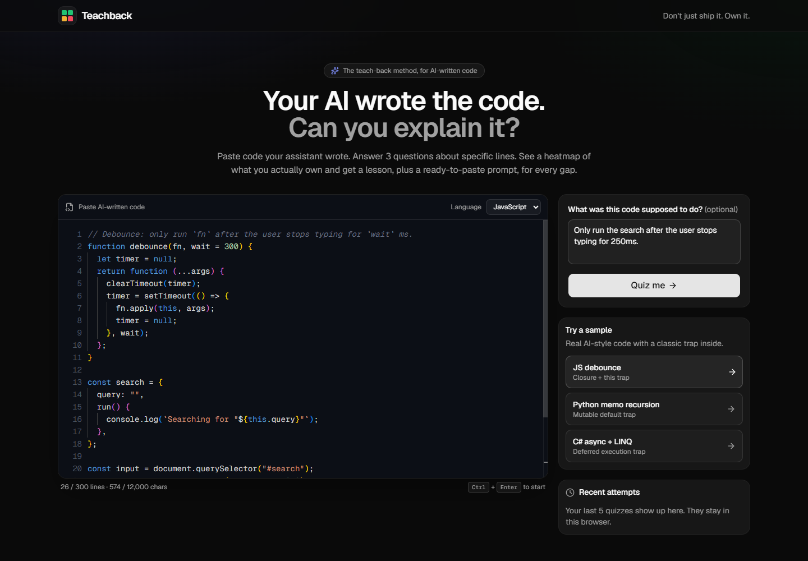
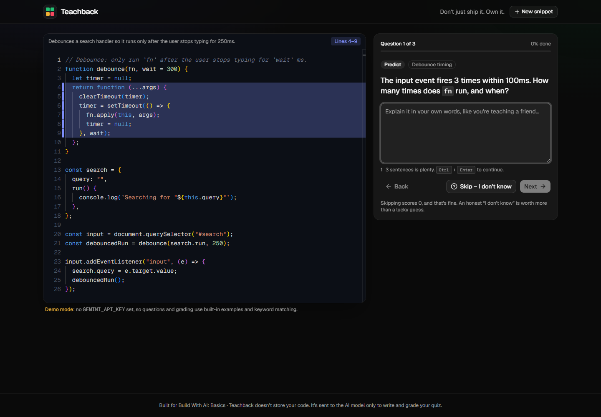
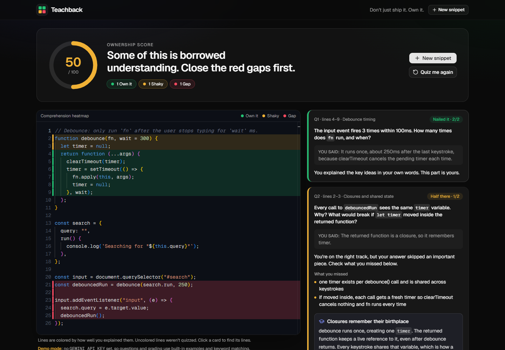

# Teachback

**Your AI wrote the code. Can you explain it?**

Teachback is a "teach-back" quiz for AI-written code. Paste a function your coding assistant wrote and Teachback asks you 3 questions about specific lines. It grades your answers and then colors the code by how well you understood each part: **green** (you own it), **amber** (shaky) or **red** (gap). Every gap gets a short lesson and a prompt you can copy straight into your coding agent.

The name comes from the teach-back method used in healthcare, where patients explain instructions back in their own words to prove they understood. Teachback does the same thing for code.

| Paste | Quiz | Heatmap |
|---|---|---|
|  |  |  |

## What it does

1. **Paste**: drop in up to 300 lines of code (or load one of 3 samples: a JS debounce with a closure/`this` trap, a Python memoized recursion with a mutable-default trap, and a C# async/LINQ method with a deferred-execution trap). You can add what the code was *supposed* to do.
2. **Quiz**: one question at a time (predict / explain / what-if). The lines each question is about glow in the editor. Answer in your own words, or hit **Skip – I don't know** (an honest skip scores 0).
3. **Results**: an Ownership score (0–100), a one-line headline and a full-code heatmap. Each question gets a card with a verdict, what you missed and a micro-lesson, plus a **Copy prompt for your coding agent** button.
4. **Recent attempts**: your last 5 quizzes are saved in `localStorage` so you can retake them.

## Run it locally

Requirements: Node.js 20+ and npm.

```bash
npm install
cp .env.example .env.local     # optional: add a GEMINI_API_KEY
npm run dev                    # http://localhost:3000
```

**No key? It still works.** Without `GEMINI_API_KEY`, Teachback runs in **demo mode**: the 3 samples use hand-written questions and lessons, other code gets heuristic questions, and grading uses keyword matching against the rubric. A "Demo mode" note shows in the UI.

**Live mode** uses Google Gemini (free tier, no credit card):

| Variable | Purpose |
|---|---|
| `GEMINI_API_KEY` | Key from <https://aistudio.google.com/apikey>. Empty = demo mode. |
| `GEMINI_MODEL` | Defaults to `gemini-3.6-flash`. Check the [models page](https://ai.google.dev/gemini-api/docs/models) for the current Flash model. |
| `QUIZ_TOKEN_SECRET` | Long random string used to encrypt quiz tokens. A dev fallback is used if empty; **set it in any deployment**. |

Other scripts:

```bash
npm test            # Vitest unit tests (quiz logic, mock grader, token sealing, LLM retry/timeout)
npm run lint        # ESLint
npm run typecheck   # tsc --noEmit
npm run build       # production build
npm start           # serve the production build
```

> The Monaco editor loads its files from the jsDelivr CDN, so you need an internet connection even in demo mode.

## How it works

- **Next.js 16 (App Router) + TypeScript** in one repo. The two API routes keep the LLM key on the server.
- `POST /api/quiz` validates the input with **zod**, sends the code to the model with every line prefixed by its number (`12| ...`) so anchors are accurate, and asks for exactly 3 questions with a private rubric. Gemini's structured output (`responseJsonSchema`) returns JSON, which is validated again with zod. Line ranges are clamped on the server.
- The rubric never reaches the browser. The server seals the quiz (code, questions, rubric) into a **`quizToken` encrypted and authenticated with AES-256-GCM**, so grading is stateless and tamper-proof. The GCM auth tag does the job the plan gave to an HMAC, and the encryption also hides the rubric.
- `POST /api/grade` opens the token, grades each answer 0/1/2, writes lessons (≤ 60 words) and agent prompts for every non-green question, and computes the overall score. Skipped answers are always 0.
- **Heatmap on the client**: lines in a question's range take that question's color, overlaps take the lowest score, and uncovered lines stay neutral. Drawn with Monaco `deltaDecorations`.
- **Resilience**: empty and too-long input are blocked before sending. LLM calls time out after 30s. Malformed JSON gets one automatic retry, then a friendly error with a **Retry** button. Rate limits (429) get their own message.
- `lib/llm.ts` is the only provider-specific file. To switch to OpenAI or Anthropic, re-implement `generateJson` there.
- Prompt-injection hygiene: the system prompts treat everything inside `<code_under_review>` and `<answer>` as data, not instructions.

```
app/api/quiz/route.ts     quiz generation
app/api/grade/route.ts    grading + lessons
lib/llm.ts                Gemini wrapper (timeout, retry, error mapping)
lib/prompts.ts            system prompts + JSON schemas
lib/quiz.ts               pure logic: numbering, clamping, scoring, heatmap
lib/token.ts              AES-GCM quiz token
lib/mock.ts               demo-mode quizzes and keyword grader
components/teachback/     paste, quiz and results screens, Monaco wrapper
tests/                    Vitest suites
```

## Pre-existing code and templates (disclosure)

- Scaffolded with `create-next-app` (Next.js 16 template).
- UI primitives from **shadcn/ui** (Button, Card, Textarea, Progress, Badge, Skeleton, Sonner) via the shadcn CLI, built on Base UI.
- Libraries: `@monaco-editor/react`, `@google/genai`, `zod`, `highlight.js` (language detection only), `lucide-react`, `sonner`, Vitest.
- Everything else was written for this hackathon, with an AI coding assistant.

## License

[MIT](LICENSE)
